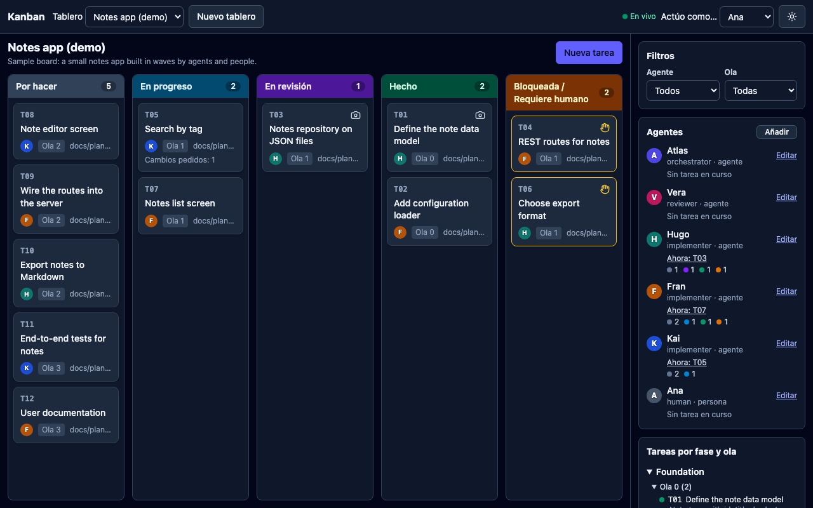
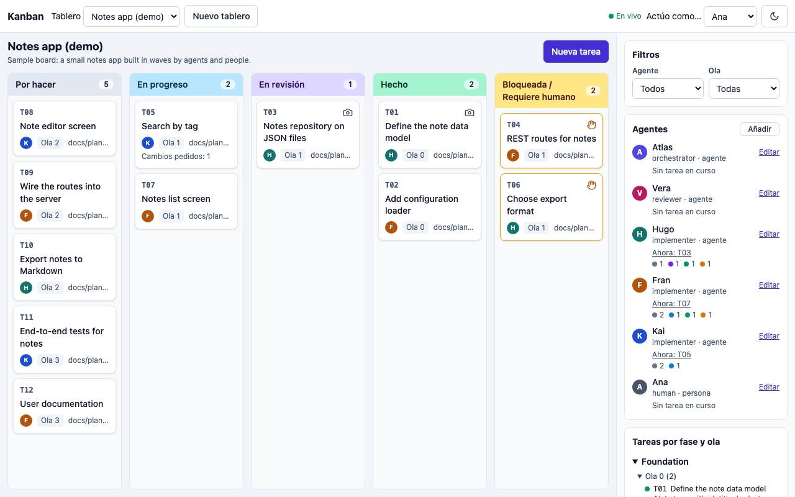
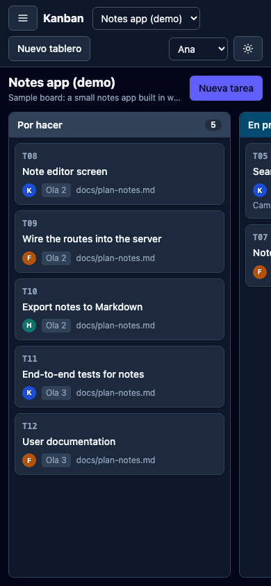

# agent-kanban

A local Kanban board for orchestrating AI agents and people. One board per feature or plan: tasks are split into waves,
assigned to named agents, reviewed before they count as done, and visible live in the browser.

- **No database.** Everything is plain files in a data folder you keep in your own project.
- **Three surfaces, one logic.** CLI, HTTP API and web UI all go through the same rules.
- **Local only.** Listens on `127.0.0.1`, no users, no authentication (see [Limits](#limits)).



| Light, desktop | Dark, mobile |
|---|---|
|  |  |

## Requirements and installation

Node.js 22 or newer.

```bash
git clone <this repo> agent-kanban && cd agent-kanban
npm install
npm run build          # builds the web app (dist/web) and compiles server + CLI (dist/)
npm link               # optional: puts `agent-kanban` on your PATH
```

Without `npm link`, run `node /path/to/agent-kanban/dist/cli/index.js <command>` instead of `agent-kanban <command>`.
The package is marked `private`; it is meant to be cloned, not published.

## Quick start with the demo board

```bash
cp -r examples/demo /tmp/kanban-demo            # work on a copy so the example stays pristine
agent-kanban up demo --data-dir /tmp/kanban-demo   # opens http://127.0.0.1:4090/#/demo
```

In another terminal, change the board from the CLI and watch the card move without reloading:

```bash
export KANBAN_DATA_DIR=/tmp/kanban-demo
agent-kanban status demo
agent-kanban move demo T07 in_progress --by fran
agent-kanban next demo
```

`examples/demo/` contains a ready-made board (6 agents, 12 tasks in 4 waves, tasks in every column, one raised hand,
a review and a screenshot as evidence). `examples/demo/seed.json` doubles as an example of the import format.
Copy it before use, as above and as the e2e tests do.

## Using it in your own project

```bash
cd my-project
agent-kanban init my-feature --title "My feature"      # data goes to ./docs/kanban by default
agent-kanban import my-feature seed.json              # tasks (+ agents) from a plan
agent-kanban validate my-feature
agent-kanban up my-feature
```

Methodology (how to turn a plan into tasks, roles, review protocol): [`docs/METHOD.md`](docs/METHOD.md).
Reusable orchestration prompt: [`docs/PROMPT_TEMPLATE.md`](docs/PROMPT_TEMPLATE.md).

## Configuration

| Setting | Flag | Environment variable | Default |
|---|---|---|---|
| Data folder | `--data-dir <dir>` | `KANBAN_DATA_DIR` (alias `AGENT_KANBAN_DATA_DIR`) | `./docs/kanban` (relative to the current directory) |
| Board | positional `<board>` (or `--board <id>`) | `AGENT_KANBAN_BOARD` | the only board, if there is exactly one |
| Acting agent | `--by <agent>` | `AGENT_KANBAN_BY` | none (required by commands that write) |
| Port | `up --port <n>` | `KANBAN_PORT` | `4090` (`0` picks a free port) |
| Machine-readable output | `--json` | none | off |

## CLI

`agent-kanban <command> [<board>] [args] [--data-dir d] [--by agent] [--json]`

The board is the first argument. `--board` and `AGENT_KANBAN_BOARD` still work as a fallback, so `<board>` can be left out.

The CLI works directly on the files, so it works with or without the server running; a running server notices the
changes and updates open browsers.

| Command | What it does |
|---|---|
| `init <board-id> --title t [--description d]` | Create an empty board. |
| `import <board> <tasks.json>` | Load or update tasks (and optionally agents, plans). Accepts a bare array of tasks too. Exit 1 if the seed has problems. |
| `validate <board>` | Check ids, assignees, dependencies, cycles and file ownership per wave. |
| `status <board>` | Text summary per state, for pasting in a chat. |
| `next <board>` | Tasks that are ready to start (dependencies done). |
| `move <board> <task> <state> [--note n]` | Move a task. States: `todo`, `in_progress`, `in_review`, `done`, `blocked`. |
| `block <board> <task> --note n [--question q]` | Block; with `--question` it raises a hand (waits for a person). |
| `unblock <board> <task> [--note n]` | Back to the previous state; the note is the answer to the question. |
| `comment <board> <task> <text...>` | Add a note to the history. |
| `preflight <board> <task> approve\|block [--note n]` | Reviewer check before work starts. |
| `review <board> <task> approve\|changes\|human [--note n] [--question q]` | Reviewer verdict on a task in review. |
| `agents <board> add <id> --name n --role r [--color c] [--kind agent\|human]` | Add an agent or person. |
| `up <board> [--port n] [--no-open]` | Start the server in the foreground and open the browser at that board (`/#/<board>`). Ctrl+C stops it. |
| `down` | Stop the server started with `up` for this data folder (uses `<data-dir>/.agent-kanban.pid`). |

`--by` is mandatory for commands that change a task. Exit codes: `0` ok, `1` domain error (message on stderr with its
`code`), `2` incorrect usage.

## Rules the tool enforces

- Valid transitions: `todo -> in_progress -> in_review -> done`, `in_review -> in_progress` (changes requested),
  any state except `done` -> `blocked`, and `blocked -> previous state`. Anything else is rejected.
- `todo -> in_progress` needs every dependency in `done` and an approved preflight.
- An agent moves only its own tasks; `orchestrator`, `reviewer` and human actors can move any. `done` is only set by a
  reviewer or a human. `preflight` and `review` can only be recorded by a reviewer or a human.
- `validate` rejects two tasks of the same wave owning the same file.

## HTTP API

JSON over `http://127.0.0.1:4090`. The actor goes in the body (`by`) or in the `x-actor` header. Errors are
`{ "error": { "code", "message" } }`.

| Route | Success |
|---|---|
| `GET /api/boards`, `GET /api/boards/:id` | 200 |
| `POST /api/boards` `{id,title,description?}` | 201 |
| `POST /api/boards/:id/tasks` `{by,task}` | 201 |
| `PATCH /api/boards/:id/tasks/:taskId` `{by,patch}` | 200 |
| `POST /api/boards/:id/tasks/:taskId/{move,block,unblock,comment,review,preflight}` | 200 |
| `POST /api/boards/:id/agents`, `PATCH /api/boards/:id/agents/:agentId` | 201 / 200 |
| `GET /api/boards/:id/events` (Server-Sent Events: `kanban` events, `ping` every 25 s) | stream |
| `GET /api/boards/:id/evidence/:taskId/:file` | file |

Error codes: `validation_error` 400, `not_assignee` 403, `not_found` 404, `invalid_transition` 409,
`dependencies_pending` 409, `preflight_required` 409. Full contract: [`docs/CONTRACT.md`](docs/CONTRACT.md).

## Data folder

```
<data-dir>/<board-id>/
  board.json        board metadata
  tasks.json        initial task definitions (the seed)
  agents.json       roster of agents and people
  events.jsonl      append-only log: the source of truth for state and history
  evidence/<task>/  screenshots and review.md
```

State is computed from the seed plus `events.jsonl`; nobody edits state by hand. Writes append one line under a file
lock, so several CLI processes and the server can write at the same time. Commit the folder to your project if you
want the history to travel with it. `<data-dir>/.agent-kanban.pid` exists only while `up` runs.

## Tests

```bash
npm run typecheck
npm test           # Vitest: core, store, app, server, CLI, web helpers
npm run build
npm run test:e2e   # Playwright; needs `npm run build` first and `npx playwright install chromium` once
```

The e2e suite starts the built server on a free port against a temporary **copy** of `examples/demo`, so the demo is
never modified. It covers: CLI move reflected live, block from the UI shows the raised hand, dark mode survives a
reload, and it regenerates the screenshots in `docs/screenshots/` (light and dark, 1280 px and 390 px).

## Why each dependency

Runtime (3):

| Package | Why |
|---|---|
| `hono` | Small, typed HTTP framework with SSE support; avoids hand-rolling routing and streaming. |
| `@hono/node-server` | Adapter that runs Hono on Node's HTTP server. |
| `zod` | Validates every request body and the seed; one schema gives both checks and types. |

Build and test only (not needed to run a built copy):

| Package | Why |
|---|---|
| `typescript`, `@types/node` | Type checking and compiling server and CLI. |
| `vite`, `@preact/preset-vite` | Bundles the web app. |
| `preact` | 3 kB React-compatible UI library, compiled into the bundle. |
| `tailwindcss`, `@tailwindcss/vite` | Styling with a class-based `dark` variant. |
| `vitest` | Unit and API tests. |
| `@playwright/test` | Browser end-to-end tests and screenshots. |
| `tsx` | Run TypeScript directly; used by the concurrency test (`node --import tsx`). |

The CLI argument parser, file locking, file watching and static serving use Node built-ins only.

## Limits

- **No authentication, no users.** The "Act as..." selector in the UI is a convenience, not security: anyone who can
  reach the port can act as any agent.
- **Local only.** The server binds to `127.0.0.1`. Do not expose it through a proxy, tunnel or `0.0.0.0` without adding
  your own authentication in front.
- Meant for one machine and a handful of concurrent writers. File locking protects the event log against concurrent
  appends; it is not a multi-user database, and network file systems may not honor the lock.
- `tasks.json` is a seed; later edits are events. Re-importing replaces the seed tasks (agents are merged); the event log is kept.
- The UI is in Spanish only.
- One server per data folder (the PID file prevents a second one).
